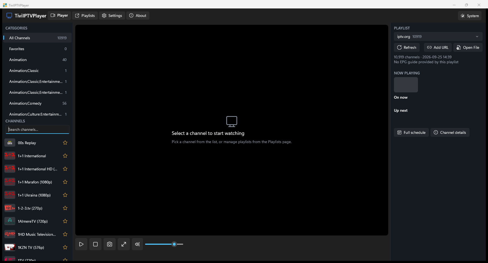

# TiviIPTVPlayer

<div align="center">

**A modern, lightweight, high-performance IPTV & Live TV Player for Windows 10 & 11 built with WinUI 3 and .NET 8.**

[](https://dotnet.microsoft.com/)
[](https://learn.microsoft.com/windows/apps/winui/winui3/)
[](https://www.microsoft.com/windows)
[](LICENSE)
[](https://github.com/uponatime2019/TiviIPTVPlayer/releases/latest)

</div>

---

## ⚡ Try It Now (Download & Run)

No installation required! Download the standalone portable package, unzip, and launch immediately:

👉 **[Download Latest Portable Release (Windows x64)](https://github.com/uponatime2019/TiviIPTVPlayer/releases/latest)**

1. Download `TiviIPTVPlayer-*-win-x64.zip` from the latest release.
2. Extract the zip to any folder.
3. Run `TiviIPTVPlayer.exe` — enjoy zero-install, instant startup!

---

## 📸 App Preview



---

## ✨ Features

- 📺 **M3U & M3U8 Playlist Support**: Load local playlist files (`.m3u`, `.m3u8`) or stream directly from remote HTTP/HTTPS URLs.
- ⚡ **Lightning Fast Parsing**: Optimized parser capable of loading playlists with over 10,000+ channels in under a second.
- 🗂️ **Smart Categorization & Search**: Automatically groups channels by category (`group-title`) with instant debounced search across all channels.
- 📅 **Integrated XMLTV Program Guide (EPG)**: Follow what's currently playing and upcoming shows with live schedule timelines.
- ⭐ **Favorites Management**: One-click star toggling to pin your favorite channels to a dedicated quick-access category.
- 🎥 **Hardware-Accelerated Playback**: Powered by Windows Media Foundation with seamless aspect-ratio scaling, mute, and volume controls.
- 📸 **High-Definition Video Snapshots**: Capture frame-accurate screenshots from live video streams saved directly to your Pictures folder.
- 🖥️ **Borderless Fullscreen**: Immersive theater mode with a single click or keyboard shortcut (`F11`).
- 🎨 **Mica & Fluent Design**: Native Windows 11 Mica backdrop with automatic System, Light, and Dark theme switching.
- 🔒 **100% Privacy & Local Storage**: No telemetry, no accounts, no subscriptions. All playlists and preferences stay strictly on your machine.

---

## 🛠️ Architecture & Tech Stack

| Component | Technology | Description |
|---|---|---|
| **UI Framework** | [WinUI 3 (Windows App SDK 1.6 / 2.4)](https://learn.microsoft.com/windows/apps/winui/winui3/) | Native Fluent UI with Mica backdrop and modern styling |
| **Runtime & Language** | C# 12 / .NET 8 (`net8.0-windows10.0.19041.0`) | Modern cross-compiled desktop runtime with high-throughput async I/O |
| **Media Engine** | `Windows.Media.Playback.MediaPlayer` | Native Windows Media Foundation playback engine |
| **Snapshot Engine** | Direct3D 11 (`d3d11.dll`) + `BitmapEncoder` | Frame-accurate hardware-accelerated video frame grabbing |
| **Package Model** | Pure Unpackaged (`WindowsPackageType=None`) | Standalone, portable executable with zero MSIX overhead |
| **JSON Serialization** | `Newtonsoft.Json` | Fast, robust playlist index and configuration persistence |

---

## ⌨️ Keyboard Shortcuts & Controls

| Shortcut | Action |
|---|---|
| <kbd>F11</kbd> / Double Click | Toggle borderless fullscreen mode |
| <kbd>Space</kbd> | Play / Pause playback |
| <kbd>M</kbd> | Mute / Unmute audio |
| <kbd>Up</kbd> / <kbd>Down</kbd> | Navigate channels list |
| <kbd>Enter</kbd> | Play selected channel |
| <kbd>Ctrl</kbd> + <kbd>F</kbd> | Focus channel search box |
| <kbd>Ctrl</kbd> + <kbd>S</kbd> | Capture video frame snapshot |

---

## 🚀 Building from Source

### Prerequisites

- [Visual Studio 2022](https://visualstudio.microsoft.com/) (version 17.8 or newer) with:
  - *.NET Desktop Development* workload
  - *Windows App SDK C# Templates*
- [.NET 8.0 SDK](https://dotnet.microsoft.com/download/dotnet/8.0)

### Clone & Build

```bash
# 1. Clone the repository
git clone https://github.com/uponatime2019/TiviIPTVPlayer.git
cd TiviIPTVPlayer

# 2. Build Debug x64
dotnet build "TiviIPTVPlayer.csproj" -p:Platform=x64

# 3. Run the application
dotnet run --project "TiviIPTVPlayer.csproj"
```

### Standalone Release Publish

```bash
dotnet publish "TiviIPTVPlayer.csproj" -c Release -p:Platform=x64 -o "publish/TiviIPTVPlayer_Portable"
```

---

## 🗺️ Roadmap

- [x] Pure unpackaged standalone architecture with zero dependencies
- [x] High-performance M3U/M3U8 parser supporting 10,000+ streams
- [x] XMLTV EPG program guide support
- [x] Frame-accurate D3D11 video snapshot capture
- [x] Mica backdrop & Fluent Design Dark/Light theme toggle
- [ ] Multi-screen / PiP (Picture-in-Picture) window mode
- [ ] Audio stream & subtitle track selection flyout
- [ ] Custom HTTP User-Agent and stream referrer headers per playlist
- [ ] Xtream Codes API integration
- [ ] Recording / DVR support for live streams

---

## 🤝 Contributing & Community

Contributions are what make the open-source community such an amazing place to learn, inspire, and create. Any contributions you make are **greatly appreciated**!

- 🐛 **Found a bug?** Open an [Issue](https://github.com/uponatime2019/TiviIPTVPlayer/issues).
- 💡 **Feature request?** Share your thoughts in [Discussions](https://github.com/uponatime2019/TiviIPTVPlayer/discussions).
- 🛠️ **Want to code?** Check out [CONTRIBUTING.md](CONTRIBUTING.md) to get started with pull requests.

---

## 📄 License

Distributed under the **MIT License**. See [`LICENSE`](LICENSE) for more information.
